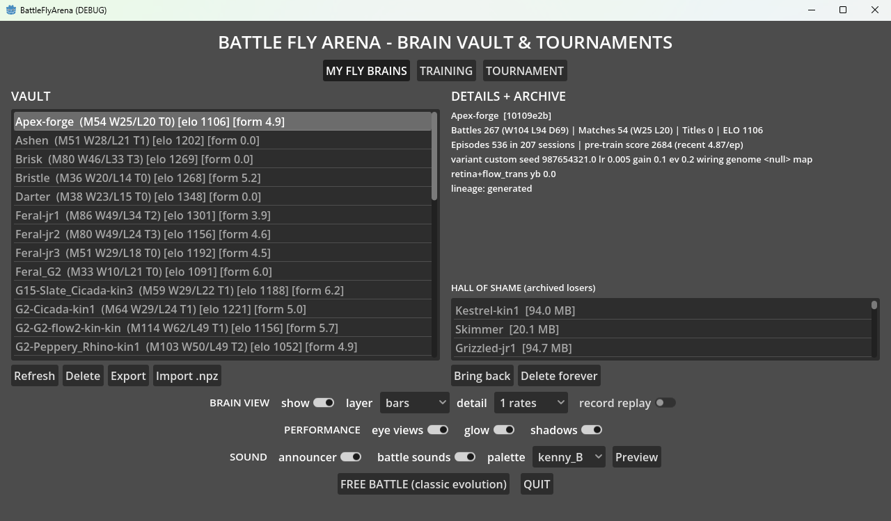

# Battle Fly Arena

Two fruit flies, each driven by its own **whole-brain spiking neural network** —
the complete 166,700-neuron, ~25.6M-synapse **MaleCNS connectome** of *Drosophila
melanogaster* — duel in a 3D forest arena. Scent tracking, visual pursuit, spike
jousting, wing tears, knockouts. After every battle, dopamine reinforcement
rewires the loser's synapses, and an evolution loop breeds the next generation.

```
Godot 4 arena (arena/)  <-- UDP 127.0.0.1:9999 -->  Python neuro-server (brain_engine/)
  FlyPhysics x2 (bodies)        20 Hz sensory steps    2x LIF brain (166,700 neurons each)
  ArenaManager / TournamentDirector                   dopamine learning + evolution + vault
```

## Screenshots & video



<video src="https://github.com/user-attachments/assets/011f1a13-80e3-4990-ac8e-ddb1734deb58" controls width="100%"></video>

[▶ Watch the battle clip (26 s, MP4)](https://github.com/user-attachments/assets/011f1a13-80e3-4990-ac8e-ddb1734deb58) — fallback link if your viewer doesn't render inline video.

*26-second exhibition battle between two vault-trained flies (Darter vs flow2-kin1, elos 1348/1347) in the Arena Glade.*

## Quickstart

```bat
:: Windows — first run auto-downloads the ~1.2 GB MaleCNS connectome data
:: (runs setup.py), then boots the neuro-server + Godot arena
launch_battle.bat
:: or
python launch_battle.py
```

To fetch the connectome data ahead of time (or on a headless machine):

```bash
python setup.py          # download ~1.2 GB of feather tables + build caches
python setup.py --check  # verify downloads only
```

On first launch the server builds `malecns_csr_base.npz` from the feather tables
(see below) — this takes a few minutes once, then it's cached.

The game opens at the **brain vault menu**. A fresh clone has an **empty vault** —
brains are per-user data and are not in git. You create your first fighters here:

1. **GENERATE + TRAIN** (menu) — name a brain, pick variant / wiring / mapping /
   seed, and it is built and trained headlessly (minimum 50 episodes so it arrives
   ring-ready). The menu shows live progress.
2. Repeat to mint 2+ brains (different seeds/wirings fight differently).
3. **QUICK BATTLE (pick 2)** — best-of-1 exhibition between two vault brains.
   **TOURNAMENT** — pick >= 2 brains, single elimination, best-of-N per match
   (optional losers bracket). **FREE BATTLE** — classic generational evolution.
   **START CONTINUOUS** — eternal tournaments: each generation archives the
   biggest loser and breeds a winner-clone plus a random wildcard (~15–25 min
   per generation, unattended).

### Headless / CLI equivalent (no Godot needed)

All vault operations are available from the command line via
`brain_engine/vault_cli.py` (run from the `brain_engine/` directory so imports
resolve; brains land in `brains/` at the repo root, or `$FLY_VAULT_DIR`):

```bash
cd brain_engine

# list what's in the vault
python vault_cli.py list

# generate + train a new brain (50 episodes minimum, trains automatically)
python vault_cli.py generate --name MyFirstFly --episodes 50

# generate with explicit params (variant, seed, learning rate, wiring, mapping...)
# variants: "charger" | "flanker" | "custom"
python vault_cli.py generate --name MyFirstFly \
  --params '{"variant":"charger","seed":1234,"learning_rate":0.008,"mapping":["retina"]}'

# retrain an existing brain (--snapshot keeps a pre-training backup)
python vault_cli.py train --id <16-hex-id> --episodes 50 --snapshot

# breed from the vault: clone a winner with noise, or mint a random wildcard
python vault_cli.py breed --strategy clone  --parent <id> --name Clone1 --seed 7 --episodes 50
python vault_cli.py breed --strategy random --name Wild1  --seed 42 --episodes 50
```

`generate` prints JSON with the new brain's record including its 16-hex `id` —
use that id for `train` / `breed --parent` / tournament selection.

To run a tournament headlessly, start the server directly and speak its UDP
protocol (see `DOCUMENTATION.md` §11), or simply use the Godot menu above.

## Requirements

| Component | Version | Notes |
|---|---|---|
| Python | 3.10+ | `numpy`, `scipy`, `pandas`, `pyarrow`, `numba` |
| Godot | 4.7.2 | Windows binaries bundled in `tools/godot/` (gitignored; download from godotengine.org for other platforms) |
| Connectome data | MaleCNS v1.0 | ~1.2 GB, auto-downloaded by `python setup.py` on first start |
| RAM / CPU | ~8+ GB RAM | a dual-brain tick costs ~140-210 ms on reference hardware |

```bash
pip install numpy scipy pandas pyarrow numba
```

## Connectome data (not in this repo)

The brain is built from the **MaleCNS v1.0** connectome (Berg et al., *Cell* 2026;
166,700 neurons, 25.6M edges, CC-BY). **You do not need to download anything
manually** — `python setup.py` (also run automatically by `launch_battle.py` on
first start) fetches the three feather tables into `connectome_data/malecns_v1/`:

```
connectome_data/malecns_v1/
  annotations.feather        # 14 MB,  sha256-verified
  neurotransmitters.feather  # 43 MB
  edges.feather              # 1.05 GB (the full connection graph)
```

Direct URLs (same files, if you prefer curl/wget):
- `https://storage.googleapis.com/flyem-male-cns/v1.0/connectome-data/flat-connectome/body-annotations-male-cns-v1.0-minconf-0.5.feather`
- `.../body-neurotransmitters-male-cns-v1.0.feather`
- `.../connectome-weights-male-cns-v1.0-minconf-0.5.feather`

Project page: https://male-cns.janelia.org/download · Interactive: https://neuprint.janelia.org (dataset `male-cns:v1.0`)

On first run the loader builds a cached CSR matrix (`malecns_csr_base.npz`, ~83 MB,
gitignored) and the derived `populations_mapped.json` (tracked, regenerable).

## Repository layout

```
arena/            Godot 4 project: scenes, scripts (GDScript), shaders, audio, models
brain_engine/     Python neuro-server: LIF kernel, connectome loader, sensory/motor
                  codecs, dopamine learning, evolution, vault (.flybrain packages)
tests/            Python test suite (tests/test_suite.py)
docs/             Neuron survey + post-mortems
setup.py          First-start: downloads MaleCNS v1.0 tables + builds caches
launch_battle.py  One-command launcher (runs setup.py if data missing, then server + arena)
DOCUMENTATION.md  Full architecture, protocol, and neuron-pool reference
```

**Data policy:** git tracks code and config only. Raw connectome data, the CSR
cache, checkpoints, the brain vault (`brains/`), tournament state, Godot binaries,
and logs are all gitignored — back them up by copying the folders.

## Testing

```bash
python tests/test_suite.py        # connectome, LIF, sensory-motor, mappings,
                                  # evolution, UDP integration, vault, trainer contract
```

Godot-side tests live in `arena/tests/` and run via headless scene runs.
CI runs the Python suite on every push/PR (`.github/workflows/tests.yml`).

See [CONTRIBUTING.md](CONTRIBUTING.md) for how to set up a dev environment and
open a PR.

## Credits & licenses

- **Connectome:** Berg et al. 2025, MaleCNS v1.0 — CC-BY (https://male-cns.janelia.org)
- **Fly body meshes:** derived from TuragaLab/flybody, Apache-2.0 — see
  [`arena/models/ATTRIBUTION.md`](arena/models/ATTRIBUTION.md)
- **Audio:** Kenny.nl SFX pack (CC0) — see `arena/audio/`
- This project's code: MIT
